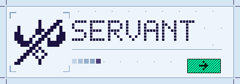
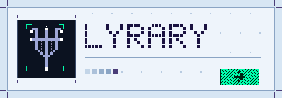
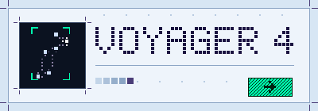
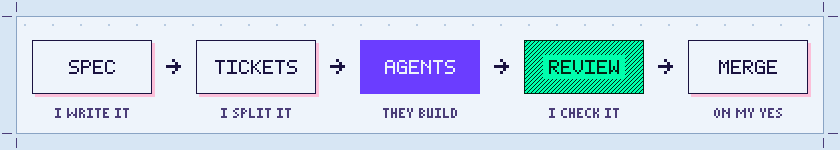

<h1 align="center"><picture><source media="(prefers-color-scheme: dark)" srcset="assets/header-night.svg"></picture></h1>

Creative Technologist · design, development &amp; AI automation

<em>I understand the business first, design the process next, and choose the tool last.</em>

<a href="https://servant.lyrary.com"><picture><source media="(prefers-color-scheme: dark)" srcset="assets/card-servant-night.svg"></picture></a>
<a href="https://lyrary.com"><picture><source media="(prefers-color-scheme: dark)" srcset="assets/card-cubierta-night.svg"></picture></a>
<a href="https://lyrary.com/voyager-4/"><picture><source media="(prefers-color-scheme: dark)" srcset="assets/card-voyager-night.svg"></picture></a>

<h3><picture><source media="(prefers-color-scheme: dark)" srcset="assets/title-work-night.svg"></picture></h3>

**[Servant](https://servant.lyrary.com)** is a modular, agent-native operations platform. Its first module is a transport quoting tool that prices routes with real Mexican toll data.

**[Portfolio](https://lyrary.com)** (lyrary.com) is my design work: the visual system below and the worlds built on it.

**[Voyager 4](https://lyrary.com/voyager-4/)** is a world-building dossier with an astronomical sky rendered on canvas.

**TESELA** (Morphotessellation) is my own visual system: a cell grid, print-shop depth instead of light, and zero radius, shadow or blur. Everything drawn on this page is drawn with it.

<h3><picture><source media="(prefers-color-scheme: dark)" srcset="assets/title-how-night.svg"></picture></h3>

<picture><source media="(prefers-color-scheme: dark)" srcset="assets/how-night.svg"></picture>

I work with AI agents as a team: I write the spec, split the work into tickets and review every delivery before it is merged.

<h3><picture><source media="(prefers-color-scheme: dark)" srcset="assets/title-stack-night.svg"></picture></h3>

<picture><source media="(prefers-color-scheme: dark)" srcset="assets/stack-night.svg"></picture>

Also: SQL, Playwright, Codex, OCR and LLM pipelines with structured output (JSON Schema), Excel.

<h3><picture><source media="(prefers-color-scheme: dark)" srcset="assets/title-contact-night.svg"></picture></h3>

[sm730358@gmail.com](mailto:sm730358@gmail.com) · [LinkedIn](https://www.linkedin.com/in/santiago-martinez-huerta) · [lyrary.com](https://lyrary.com)
